## Quién soy

  
  

## Herramientas que uso

### Desarrollo, área primaria

<table>
  <tr>
    <td width="50%" valign="top">
      <b>Lenguajes</b>  
       
      <code>TypeScript</code> <code>JavaScript</code> <code>Python</code> <code>C++</code>
    </td>
    <td width="50%" valign="top">
      <b>Frontend</b>  
       
      <code>React</code> <code>Next.js</code> <code>Astro</code> <code>Vite</code> <code>Tailwind</code>
    </td>
  </tr>
  <tr>
    <td width="50%" valign="top">
      <b>Backend y APIs</b>  
       
      <code>Node.js</code> <code>FastAPI</code>
    </td>
    <td width="50%" valign="top">
      <b>Datos</b>  
      &nbsp;&nbsp; 
      <code>MySQL</code> <code>Amazon RDS</code>
    </td>
  </tr>
  <tr>
    <td width="50%" valign="top">
      <b>Nube y sistema</b>  
       
      <code>AWS Lambda</code> <code>Docker</code> <code>Linux sobre WSL</code>
    </td>
    <td width="50%" valign="top">
      <b>Escritorio y audio</b>  
       
      <code>Electron</code> <code>whisper.cpp</code>
    </td>
  </tr>
  <tr>
    <td width="50%" valign="top">
      <b>Pruebas y automatización</b>  
       
      <code>Vitest</code> <code>GitHub Actions</code> <code>Bash</code>
    </td>
    <td width="50%" valign="top">
      <b>Flujo de trabajo</b>  
       
      <code>Git</code> <code>GitHub</code> <code>pnpm</code> <code>VS Code</code>
    </td>
  </tr>
</table>

### Electrónica, área secundaria

<table>
  <tr>
    <td width="50%" valign="top">
      <b>Circuitos y PCB</b>  
&nbsp;&nbsp; 
      <code>Proteus</code> <code>EasyEDA</code> y otras con licencia libre
    </td>
    <td width="50%" valign="top">
      <b>Microcontroladores</b>  
      &nbsp;&nbsp; 
      <code>Arduino</code> <code>MPLAB</code>
    </td>
  </tr>
  <tr>
    <td width="50%" valign="top">
      <b>Automatización y neumática</b>  
 
      <code>Siemens TIA Portal</code> <code>PLC</code>
    </td>
    <td width="50%" valign="top">
      <b>Cálculo y simulación</b>  
      &nbsp;&nbsp; 
      <code>MATLAB</code> <code>Wolfram</code> <code>Python</code>
    </td>
  </tr>
  <tr>
    <td width="50%" valign="top">
      <b>Redes y telecomunicaciones</b>  
 
      <code>Cisco</code>
    </td>
    <td width="50%" valign="top">
      <b>Ciberseguridad</b>  
 
      <code>OWASP</code>
    </td>
  </tr>
</table>

## Qué es Dark4rest

**[Dark4rest](https://github.com/DavidRodriguezSilva/dark4rest)** es una biblioteca de
herramientas pequeñas que funcionan sin internet. Sin cuentas, sin nube, sin telemetría.
Cada herramienta se instala, se abre y se usa en tu máquina.

## Las apps

<table>
  <tr>
    <td align="center" width="33%">
      <a href="https://github.com/DavidRodriguezSilva/dark-echo"> <b>dark-echo</b></a> 
      Lluvia, viento y ruido de color generados en vivo, sin bucles que se repitan 
      <a href="https://davidrodriguezsilva.github.io/dark-echo/">Escúchalo en el navegador</a>
    </td>
    <td align="center" width="33%">
      <a href="https://github.com/DavidRodriguezSilva/dark-owl"> <b>dark-owl</b></a> 
      Dicta y obtén el texto, sin que el audio salga de tu máquina 
      <a href="https://github.com/DavidRodriguezSilva/dark-owl">Ver cómo se instala</a>
    </td>
    <td align="center" width="33%">
      <a href="https://github.com/DavidRodriguezSilva/kalndr"> <b>kalndr</b></a> 
      Festivos de Colombia, puentes y las mejores fechas de vacaciones 
      <a href="https://davidrodriguezsilva.github.io/kalndr/">Ver los próximos festivos</a>
    </td>
  </tr>
</table>

En camino: texto a voz y un traductor, también sin conexión.
[Ver el roadmap](https://github.com/DavidRodriguezSilva/dark4rest/blob/main/docs/roadmap.md)
