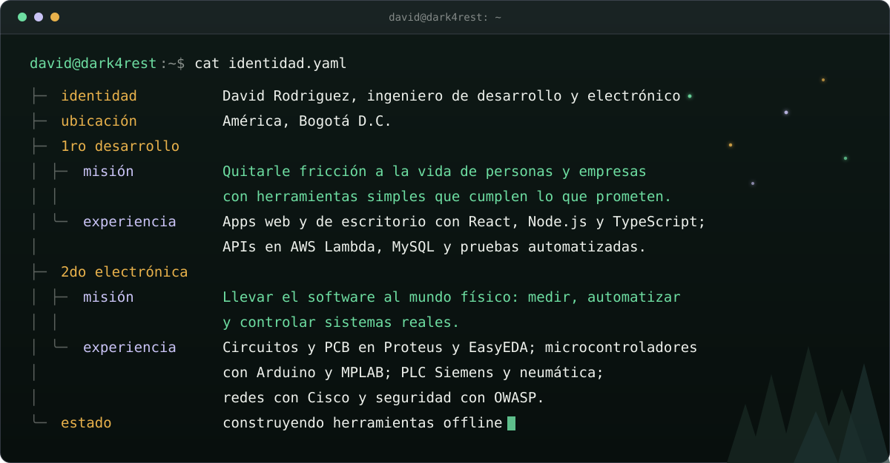

 

### Quién soy

 

### Herramientas que uso

`lenguajes` 
 
TypeScript, JavaScript, Python, C++

`web y escritorio` 
 
React, Astro, Vite, Tailwind, Electron, Node.js

`nube y sistema` 
 
AWS Lambda, Docker, Linux sobre WSL

`flujo de trabajo` 
 
Git, GitHub, pnpm, Vitest

 

### Qué es Dark4rest

**[Dark4rest](https://github.com/DavidRodriguezSilva/dark4rest)** es una biblioteca de
herramientas pequeñas que funcionan sin internet. Sin cuentas, sin nube, sin telemetría.
Cada herramienta se instala, se abre y se usa en tu máquina.

 

### Las apps

<table>
  <tr>
    <td align="center" width="33%">
      <a href="https://github.com/DavidRodriguezSilva/dark-echo"> <b>dark-echo</b></a> 
      Lluvia, viento y ruido de color generados en vivo, sin bucles que se repitan 
      <a href="https://davidrodriguezsilva.github.io/dark-echo/">Escúchalo en el navegador</a>
    </td>
    <td align="center" width="33%">
      <a href="https://github.com/DavidRodriguezSilva/dark-owl"> <b>dark-owl</b></a> 
      Dicta y obtén el texto, sin que el audio salga de tu máquina 
      <a href="https://github.com/DavidRodriguezSilva/dark-owl">Ver cómo se instala</a>
    </td>
    <td align="center" width="33%">
      <a href="https://github.com/DavidRodriguezSilva/kalndr"> <b>kalndr</b></a> 
      Festivos de Colombia, puentes y las mejores fechas de vacaciones 
      <a href="https://davidrodriguezsilva.github.io/kalndr/">Ver los próximos festivos</a>
    </td>
  </tr>
</table>

 

En camino: texto a voz y un traductor, también sin conexión.
[Ver el roadmap](https://github.com/DavidRodriguezSilva/dark4rest/blob/main/docs/roadmap.md)
